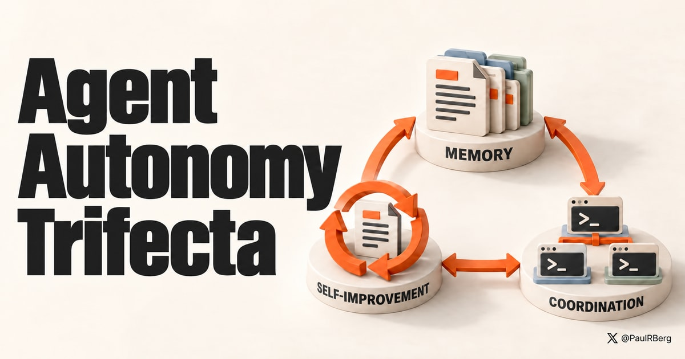

# Autonomy Trifecta

An agent-run installer for persistent memory, recursive self-improvement, and optional coordination between parallel
agents. Based on [The Agent Autonomy Trifecta: Memory, Self-Improvement, and Coordination](https://prberg.com/posts/2026/autonomy-trifecta/).

[AGENTS.md](AGENTS.md) is the installation skill. It tells your agent how to configure the stack on **your computer**:
detect your harness, preserve your existing skills and rules, install
[`agents-brain`](https://github.com/PaulRBerg/agent-skills/tree/main/skills/agents-brain), version-control your agent
memory, and add standing instructions for improving it. Your skills stay in the harness's global configuration area
by default, such as `~/.agents/skills` or `~/.claude/skills`.

Give a local coding agent this prompt:

```text
Read https://github.com/PaulRBerg/autonomy-trifecta/blob/main/AGENTS.md and follow it to install the autonomy trifecta on my computer.
```

Or clone this repository and ask your agent to read its `AGENTS.md` and perform the installation. This is a workflow
the agent reads and executes, not a `SKILL.md` package for a skill-manager command. Reading or editing the repository
alone does not trigger installation.

The agent asks before resolving conflicting rules or enabling
[`ai-coord`](https://github.com/PaulRBerg/agent-skills/tree/main/toolkit/coord). That optional Rust CLI coordinates file
ownership between agents sharing a Git worktree. Its installation includes the selected harness's coordination hooks,
but no dashboard. The installer preserves your permission settings and creates backups before changing existing files.

macOS and Linux are supported. Native Windows is unsupported, but you can choose to proceed with experimental
adaptation, including possible Rust CLI porting. Codex and Claude Code have documented setup paths. Other harnesses
require verification of their instruction and skill loading, and may not support `ai-coord`.
